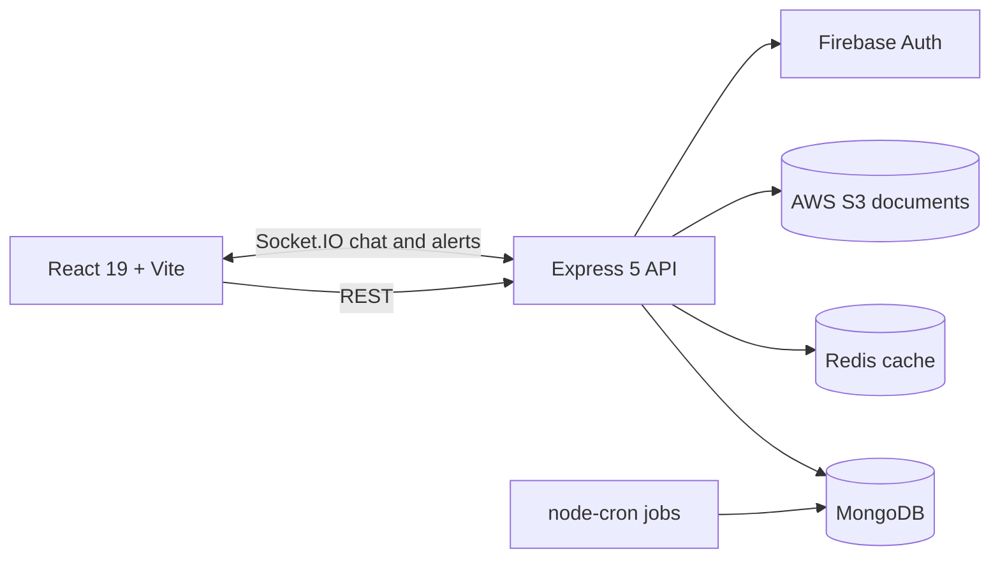

# CareConnect

**One shared workspace where families, caregivers and the person receiving care coordinate tasks, medications, vitals, documents and chat.**

## The problem

Caring for a family member usually means a group chat, a paper medication list and nobody sure who did what. CareConnect puts the whole care team on one schedule with clear roles and real time alerts.

## What it does

- Family groups with five roles: admin, caregiver, family member, read only, and care recipient.
- Care tasks with due dates and daily, weekly or monthly repeats, reminders five minutes before and at the due time, and overdue tasks marked missed automatically.
- Medication logs and vitals (blood pressure, heart rate, weight, glucose, temperature) with trend charts.
- Real time group chat and a panic button that alerts every group member instantly over Socket.IO.
- Medical documents in AWS S3 behind signed URLs, and email invites for people not yet on the platform.

## Architecture



| Background job | Schedule |
|---|---|
| Task due reminders | Every minute |
| Mark overdue tasks missed | Every 15 minutes |
| Create next recurring task | Nightly |
| Clear old notifications | Nightly |

## Tech stack

| Layer | Technology |
|---|---|
| Frontend | React 19, Vite, Tailwind CSS 4, Recharts, Socket.IO client |
| Backend | Node.js, Express 5, Mongoose, Redis, Socket.IO, node-cron, Nodemailer |
| Auth | Firebase Authentication (email and password, Google) |
| Storage | MongoDB, AWS S3 (SDK v3) |
| Infra | Docker Compose (api, web, mongo, redis), AWS EC2 |

## Highlights

- 40+ REST endpoints across 12 route modules, guarded by role based access control.
- Four service Docker stack and four scheduled background jobs.
- Deleting an account transfers group ownership to the next member, or removes the group and its tasks, messages and memberships when no one is left.

## Run it locally

Needs Docker, a Firebase project (service account key) and an AWS S3 bucket.

```bash
git clone https://github.com/HarshilModh/Care_Connect.git
cd Care_Connect
cp backend/.env.example backend/.env      # add your own keys
cp frontend/.env.example frontend/.env
docker compose up --build
# web: http://localhost:5173   api: http://localhost:3000
```

Without Docker, run MongoDB and Redis locally, then `npm install && npm start` in `backend/` and `npm install && npm run dev` in `frontend/`.
