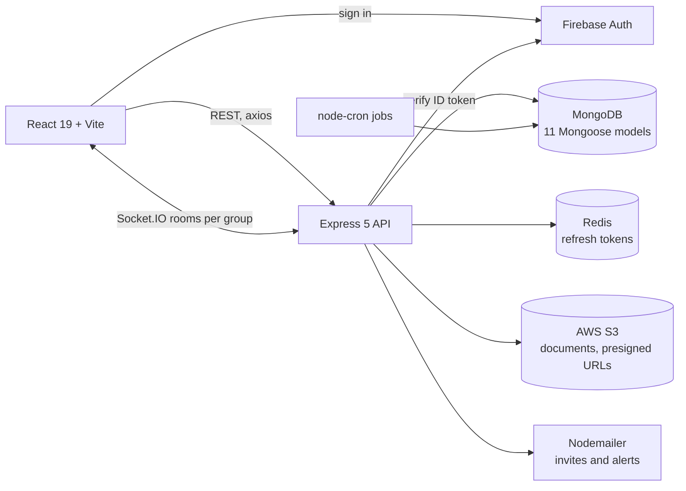

# CareConnect

**One shared workspace where families, caregivers and the person receiving care coordinate tasks, medications, vitals, documents and chat.**


## Contents

- [Architecture](#architecture)
- [The problem](#the-problem)
- [At a glance](#at-a-glance)
- [Features](#features)
- [Roles](#roles)
- [Real time layer](#real-time-layer)
- [Panic alert flow](#panic-alert-flow)
- [Authentication](#authentication)
- [Background jobs](#background-jobs)
- [Data model](#data-model)
- [Engineering decisions](#engineering-decisions)
- [Tech stack](#tech-stack)
- [API overview](#api-overview)
- [Run it locally](#run-it-locally)
- [Repository layout](#repository-layout)

## Architecture



## The problem

Caring for a family member usually means a group chat, a paper medication list and nobody sure who did what. CareConnect puts the whole care team on one schedule with clear roles, so everyone can see what is due, what was done and who did it, and get alerted when something goes wrong.

## At a glance

| | |
|---|---|
| **Who uses it** | Family members, paid caregivers and the person receiving care, together in one family group |
| **Core features** | Care tasks and calendar, medications, vitals, documents, group chat and a panic button |
| **Real time** | Chat, typing indicators, read receipts and alerts over Socket.IO |
| **Backend surface** | 117 REST endpoints across 11 resource routers |
| **Automation** | 4 scheduled jobs for reminders, missed tasks, repeats and cleanup |
| **Deployment** | Four service Docker Compose stack (API, web, MongoDB, Redis), run on AWS EC2 |

## Features

**Care tasks and calendar**
- Tasks, medication reminders, events and notes, each assigned to a member of the group.
- Repeat daily, weekly or monthly. The next occurrence is created automatically.
- Reminders 5 minutes before a task is due and at the due time.
- Tasks still pending after their due time are marked missed automatically.
- Complete, undo, reassign and search tasks, and see them on a month, week or day calendar (react-big-calendar).

**Medications**
- Medication schedules that are daily, weekly or as needed.
- Record each dose as it is taken, so the group can see what was given and when.

**Vitals**
- Log blood pressure, heart rate, weight, glucose and temperature.
- History and latest reading per person, with trend charts (Recharts).

**Documents**
- Upload several files at once, up to 10 MB each, stored in AWS S3.
- Files are shared through presigned URLs that expire (one hour by default), so documents are never public.

**Family groups**
- Create a group, invite members by email, and set its time zone and public or private visibility.
- People who aren't on CareConnect yet get a welcome email with a link to set their password.
- Membership requests can be accepted or rejected, and each member has an active, pending or removed status.

**Group chat**
- Real time messages with edit, delete, search, read receipts, typing indicators and unread counts.

**Caregiver and care recipient profiles**
- Onboarding flows for caregivers (skills and certifications, both searchable) and care recipients (conditions, searchable).

**Notifications**
- In app notifications for reminders, join requests and emergencies, with read, read all and cleanup.

**Account deletion**
- Deleting an account hands each group it owns to the next admin or family member, or removes the group with its tasks, messages and memberships when no one is left.

## Roles

Every membership carries one of five roles:

| Role | Typical person |
|---|---|
| `admin` | The family member who runs the group |
| `familyMember` | Relatives helping with care |
| `careGiver` | A paid or professional caregiver |
| `careRecipient` | The person receiving care |
| `readonly` | Someone who should see updates but not change them |

Role values are validated on every membership change, and task creation and editing check the member's role in that group.

## Real time layer

Each family group is a Socket.IO room (`group:<id>`).

| Event | Direction | Purpose |
|---|---|---|
| `join-group`, `leave-group` | client to server | Enter or leave a group's room |
| `user-joined`, `user-left` | server to room | Presence |
| `typing` / `user-typing` | both | Typing indicator |
| `message-read` / `message-read-by` | both | Read receipts |
| `new-message`, `message-edited`, `message-deleted` | server to room | Chat updates pushed the moment the API saves them |

## Panic alert flow

One tap on the panic button (`POST /api/family-groups/group/:id/panic`) reaches the whole care team three ways at once:

1. An **emergency notification** for every active member of the group.
2. A **panic message in the group chat**, pushed to everyone online over Socket.IO.
3. An **email alert** to every other member, with the group and the name of the person who raised it.

## Authentication

- Sign up and sign in with **Firebase Authentication** (email and password, or Google).
- The API verifies the Firebase ID token with the Firebase Admin SDK, then issues its **own JWT access token and refresh token**.
- **Refresh tokens are stored in Redis with a TTL** (7 days by default), and every refresh is checked against Redis, so signing out, changing a password or deleting an account revokes them immediately.
- The auth middleware accepts either the API's JWT or a Firebase ID token, and attaches the user and role to the request.
- Email verification, password change and password reset are supported.

## Background jobs

Scheduled with node-cron inside the API:

| Job | Schedule |
|---|---|
| Send task due reminders (5 minutes before and at due time) | Every minute |
| Mark overdue tasks missed | Every 15 minutes |
| Create the next occurrence of repeating tasks | Nightly |
| Clear old notifications | Nightly |

## Data model

11 Mongoose models in MongoDB:

| Model | Holds |
|---|---|
| `User` | Profile, sign in details, account role |
| `FamilyGroup` | Group name, owner, time zone, visibility |
| `Membership` | A user's role and status in a group |
| `CareRecipient` | The person receiving care and their conditions |
| `CareGiver` | Caregiver skills and certifications |
| `Task` | Title, type, assignee, due time, repeat rule, status |
| `Medication` | Medication schedule and dose records |
| `Vital` | One reading of a vital sign |
| `Document` | File metadata and its S3 key |
| `Chat` | Group messages and their read status |
| `Notification` | Reminders, requests and emergency alerts |

## Engineering decisions

- **Rooms per group.** Every chat and alert event is scoped to `group:<id>`, so members only receive updates for groups they belong to.
- **Revocable refresh tokens.** Keeping refresh tokens in Redis with a TTL makes sign out, password changes and account deletion take effect right away, which a stateless token alone can't do.
- **Private documents by default.** Files are never served directly. Every view gets a time limited presigned S3 URL.
- **Jobs over client timers.** Reminders, missed task marking and repeating tasks run on the server, so they still happen when nobody has the app open.
- **Safe account deletion.** Ownership moves to another member before a user is removed, so a family doesn't lose its group because one person left.
- **Config from the environment.** All secrets load from environment variables, with `.env.example` files for the backend and frontend.

## Tech stack

| Layer | Technology |
|---|---|
| Frontend | React 19, Vite 7, Tailwind CSS 4, React Router 7, Recharts, react-big-calendar, Framer Motion, axios, Socket.IO client |
| Backend | Node.js, Express 5, Mongoose 8, Redis, Socket.IO, node-cron, Nodemailer, multer |
| Auth | Firebase Authentication (email and password, Google), Firebase Admin SDK, JWT, bcrypt |
| Storage | MongoDB 7, Redis 7, AWS S3 (SDK v3, presigned URLs) |
| Infra | Docker Compose (api, web, mongo, redis), AWS EC2 |

## API overview

117 endpoints under `/api`:

| Router | Base path | Covers |
|---|---|---|
| Users | `/api/users` | Sign up, sign in, Google, refresh, sign out, profile, password, email verification, delete |
| Family groups | `/api/family-groups` | Create, search, members, stats, time zone, visibility, panic |
| Memberships | `/api/memberships` | Add, bulk add, role and status changes, leave, filters by status and role |
| Tasks | `/api/tasks` | Create, search, update, complete, undo, reassign, list by group |
| Medications | `/api/medications` | Create, update, delete, record a dose |
| Vitals | `/api/vitals` | Add, history, latest, delete |
| Documents | `/api/documents` | Upload, list, delete |
| Chats | `/api/chats` | Send, list, recent, search, edit, delete, read status, unread count |
| Notifications | `/api/notifications` | List, read, read all, join requests, cleanup |
| Care recipients | `/api/care-recipients` | Profiles, search, filter by condition |
| Caregivers | `/api/caregivers` | Profiles, search, filter by skill or certification |

## Run it locally

Needs Docker, a Firebase project (service account key) and an AWS S3 bucket.

```bash
git clone https://github.com/HarshilModh/Care_Connect.git
cd Care_Connect
cp backend/.env.example backend/.env      # add your own keys
cp frontend/.env.example frontend/.env
docker compose up --build
# web: http://localhost:5173   api: http://localhost:3000
```

The Firebase service account can be given as `FIREBASE_SERVICE_ACCOUNT_JSON` (the JSON itself) or `FIREBASE_SERVICE_ACCOUNT_PATH` (a file path).

Without Docker, run MongoDB and Redis locally, then `npm install && npm start` in `backend/` and `npm install && npm run dev` in `frontend/`.

## Repository layout

| Folder | What it is |
|---|---|
| `backend/routes` | Express routers, one per resource |
| `backend/data` | Business logic for each resource |
| `backend/models` | Mongoose models |
| `backend/integrations` | Firebase Admin, S3, email |
| `backend/services` | Scheduled jobs |
| `backend/middlewares` | Auth middleware |
| `frontend/src` | React app: pages, components, API client, auth context |
